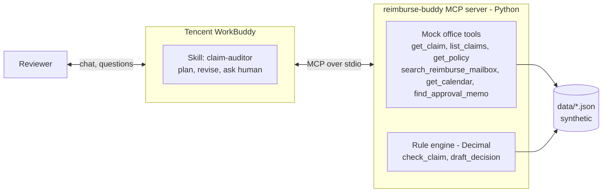

# reimburse-buddy

> The hackathon submission is the WorkBuddy skill + MCP server. `web/` is a separate simulation UI (no LLM) and is not part of the judged demo.

An office agent that audits business-travel expense claims, built for the
**Tencent Cloud Hackathon 2026 (Office Agent track)** on **Tencent WorkBuddy**.

The agent reads a claim, plans its review, spots gaps, goes looking for evidence
(shared reimburse@ mailbox, calendar, approval memos), revises its plan on screen, asks a human only when
it has to, and drafts a decision. Every Rupiah figure comes from a deterministic Python
rule engine, never from the language model.

> All data in this repository is synthetic. Company, people, hotels and emails are fictional.

## Architecture



- **WorkBuddy** does the reasoning: planning, tool choice, plan revision and the human-in-the-loop.
- **Python** does what must be exact: data access and policy arithmetic.

## Tools

| Tool | Purpose |
|---|---|
| `list_claims(status)` | Claims waiting for review |
| `get_claim(claim_id)` | Claim, trip, items and employee |
| `get_policy()` | Travel policy: city tiers, hotel caps, per diem, receipt rules |
| `search_reimburse_mailbox(employee_id, query)` | Search the shared reimburse@ mailbox that employees forward evidence to (boarding passes, receipts, schedule changes). Personal inboxes are never read. |
| `approve_cleared_batch(batch_id, claim_ids, reviewer_confirmed)` | (Mock write) Bulk-approve the claims triage cleared, only with explicit reviewer confirmation and the exact cleared list |
| `get_calendar(employee_id, date_from, date_to)` | Mock calendar |
| `find_approval_memo(employee_id, city, date)` | Hotel-cap exception memos |
| `check_claim(claim_id, evidence_ids, human_decisions)` | Deterministic rule check |
| `triage_claims(batch)` | Split a batch into auto-cleared claims and exceptions, with a time-saved estimate |
| `draft_decision(..., language)` | Reviewer-ready decision note: `id`, `en` or `both` (default, Bahasa Indonesia first) |
| `send_message(to, body, subject, claim_id)` | (Mock write) Email an employee; goes to the outbox |
| `request_approval(manager_id, claim_id, item_id, reason)` | (Mock write) Ask the claimant's manager; returns a pending request |
| `update_claim_status(claim_id, status, note)` | (Mock write) `on_hold`, `approved`, `partially_approved`, `rejected` |
| `get_outbox()` | Everything the agent sent or changed this session |
| `reset_demo()` | Restore all in-memory state before a new take (replies, outbox, approvals, statuses) |

Write tools are mocks: state lives in memory for one server process. `send_message` is a
closed loop: scripted replies in `data/replies.json` are the employee's answer and land in the reimburse@ mailbox right away,
so the agent can `search_reimburse_mailbox` and pass the reply's ID to `check_claim`.

Rules in `check_claim`:

- hotel nightly cap by city tier (or a signed memo), and hotel nights inside the trip
- per diem per trip day
- receipt required; a receipt forwarded to the reimburse mailbox counts
- boarding pass must match flight number, date and passenger name
- expense dates within the trip
- duplicates keyed on receipt number (no distinct receipt numbers means `duplicate_suspected`, not auto-reject)
- late check-out justified by a business meeting in the same city that ends after the standard check-out
  time, with the requested check-out at most 2 hours after the meeting (fee capped at 50% of the nightly cap)
- claim-level warning when an outbound flight has no return flight

Unresolved problems come back as **gap codes** (`receipt_missing`, `boarding_pass_missing`,
`hotel_over_cap`, `hotel_nights_mismatch`, `late_checkout_unjustified`, `duplicate_suspected`,
`return_flight_missing`). The skill maps each code to a tool. `human_decisions`
(`approve_full` / `approve_capped` / `reject`) can settle any item, in any category.
`ignored_evidence` lists IDs that did not count and why (`unknown_id`, `belongs_to_other_employee`, `memo_unsigned`,
`no_matching_item`). Wrong argument shapes return an error with a correct example, so the model can retry.

`search_reimburse_mailbox` is a ranked OR search (case-insensitive, `QZ7520` = `QZ 7520`, identifiers weigh more) that
returns the top 5 summaries. Scripted replies react to English and Indonesian requests (receipt, struk,
kuitansi, nota, bukti, taksi). The decision note's Indonesian section is fully localised and lists ignored
evidence as an audit trail.

## Demo scenarios

| # | Claim | What happens |
|---|---|---|
| Triage | batch `2026-W43` | `triage_claims` checks 10 claims: 7 clean ones are auto-cleared, 3 exceptions are investigated. Time-saved estimate: ~105 min (15 min per auto-cleared claim, a stated synthetic assumption). |
| Hero | `CLM-2026-0110` | Four problems in one claim. (a) Searching "boarding pass" only finds another trip; the airline email says "Check-in successful: QZ 7520", so the agent retries with the flight number. (b) The only hotel memo, `MEMO-2026-038`, is **unsigned**, so `check_claim` ignores it (`memo_unsigned`) and the agent asks the reviewer. (c) The calendar says the meeting ended 11:30, but an email moved it to 13:00-15:00; together they justify the 16:30 check-out. (d) The taxi receipt is missing; the agent emails Rina and her reply carries the receipt. |
| 1 | `CLM-2026-0101` | Flight has no boarding pass. Agent searches the reimburse mailbox, finds `MSG-5001`, claim approved. |
| 2a | `CLM-2026-0102` | Jakarta hotel over cap. Agent finds signed memo `MEMO-2026-041`, approved. |
| 2b | `CLM-2026-0103` | Medan hotel over cap, no memo. Agent asks the reviewer; capped amount approved. |
| 3 | `CLM-2026-0104` | Late check-out fee. Calendar shows a contract signing until 15:30, so the fee is justified. A post-trip dinner is rejected and a suspected duplicate taxi goes to the reviewer. |

Run them without WorkBuddy:

```bash
uv run python -m reimburse_buddy.demo boarding-pass   # or triage, hero, hotel-memo, hotel-ask, late-checkout, all
```

## Setup

Requires Python 3.11+ and [uv](https://docs.astral.sh/uv/).

```bash
git clone https://github.com/imam-db/reimburse-buddy.git
cd reimburse-buddy
uv sync
uv run pytest            # rule tests + a real MCP stdio round-trip
uv run reimburse-buddy-mcp   # starts the server on stdio (WorkBuddy normally does this)
```

## Plug into WorkBuddy

1. Copy `.workbuddy/mcp.json` into your project's `.workbuddy/` folder (or merge it into
   `~/.workbuddy/mcp.json`) and replace `/ABSOLUTE/PATH/TO/reimburse-buddy` with your clone path.
   On Windows use a path like `C:\\Users\\you\\reimburse-buddy`.
2. Restart WorkBuddy and confirm the `reimburse-buddy` server shows its 14 tools.
3. Add the skill in `skills/claim-auditor/SKILL.md` to WorkBuddy's skills. It covers the gap-code-to-tool
   mapping, the fallback search strategy, how to explain `ignored_evidence`, batching questions to the
   reviewer, and post-decision actions.
4. Try: *"Triage batch 2026-W43."* or *"Review claim CLM-2026-0110."*

To point the server at another dataset, set `REIMBURSE_BUDDY_DATA=/path/to/data` in the `env` block.

## Project layout

```
src/reimburse_buddy/
  server.py      MCP server (FastMCP, stdio)
  rules.py       deterministic rule engine
  decision.py    decision note renderer
  data_store.py  JSON data access + mock tools
  models.py      result types, Decimal helpers
  triage.py      batch triage
  demo.py        scripted scenarios
data/            synthetic employees, policy, claims, reimburse mailbox (inbox.json), calendar, memos
skills/claim-auditor/SKILL.md
.workbuddy/mcp.json
tests/
```

## Human in the loop

The agent proposes, the reviewer confirms. `triage_claims` is read-only; cleared claims change status only
through `approve_cleared_batch(..., reviewer_confirmed=true)` with the exact cleared list. Final status
changes, rejections, above-cap approvals, escalations and decision notices always wait for the reviewer.
Gathering evidence and asking an employee for a missing document happen automatically.

In a real deployment the evidence source is a dedicated reimburse@ mailbox that employees forward
documents to, plus connectors for calendar, HR and ERP. The mock MCP tools here stand in for those.

## License

MIT

## Beyond the hackathon

### Web simulation UI (`web/`)

Not part of the judged demo. `web/` holds a small two-sided FastAPI app that imports the same core (`data_store`, `rules`, `decision`,
`triage`). It needs no LLM: the reviewer investigates and the rule engine computes every amount. A LangGraph agent (the planned
version B) will later plug in at `investigate()` and call the tools over MCP.

- Employee portal (`/employee`): submit a claim, forward evidence to the reimburse@ mailbox (files are kept
  locally in `web/uploads/` as synthetic attachments), see claim status and messages from finance.
- Finance admin (`/admin`): read-only triage, bulk approval only with an explicit confirmation, and a claim page
  with findings, gap codes, ignored evidence, mailbox search, calendar, memos, item decisions, a bilingual note
  preview, and a status change that needs the reviewer's tick. "Reset demo data" restores the seed data.

```bash
uv sync
uv run uvicorn --app-dir web reimburse_web.app:app --port 8000
# open http://127.0.0.1:8000/admin
```

Known limits before any public deploy: shared in-memory state, no auth, local uploads (basic 5 MB / type
limits only), and evidence metadata typed by the employee rather than extracted from the file.
